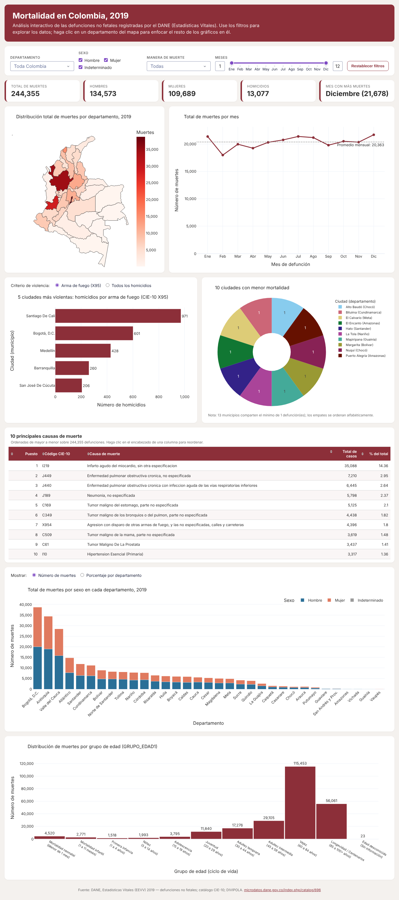
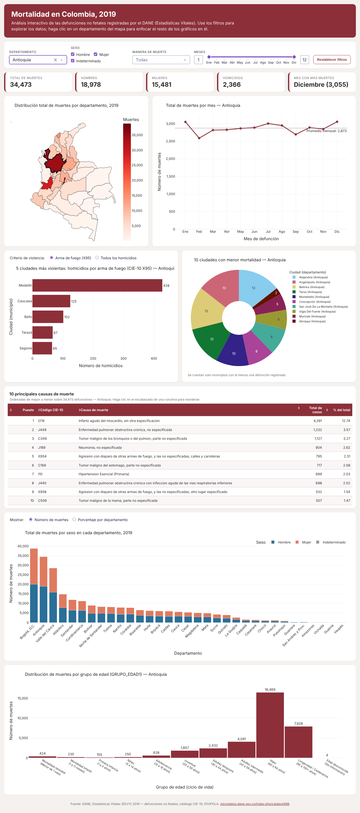
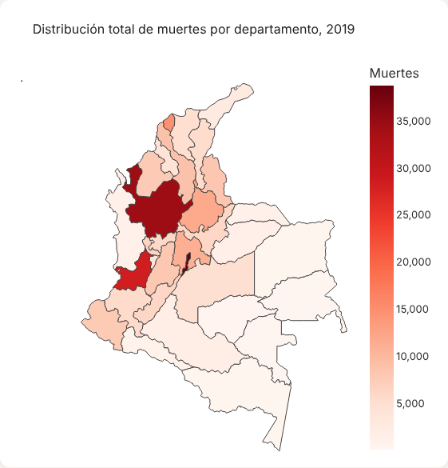
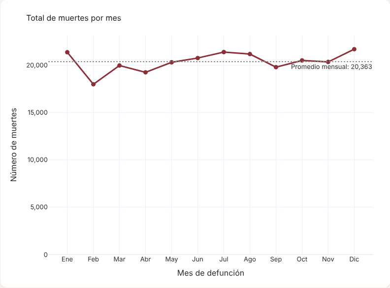
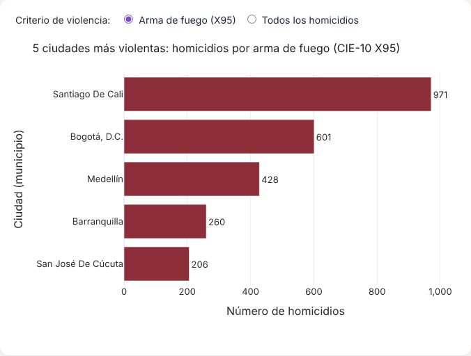
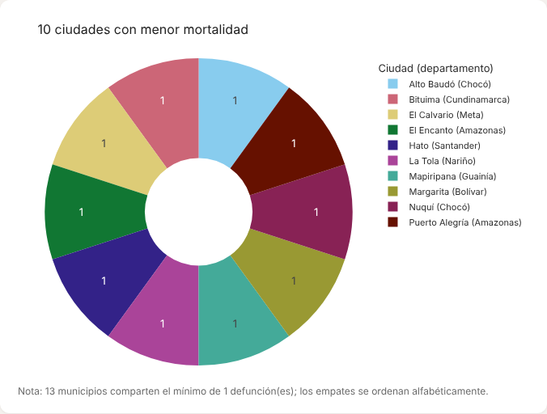
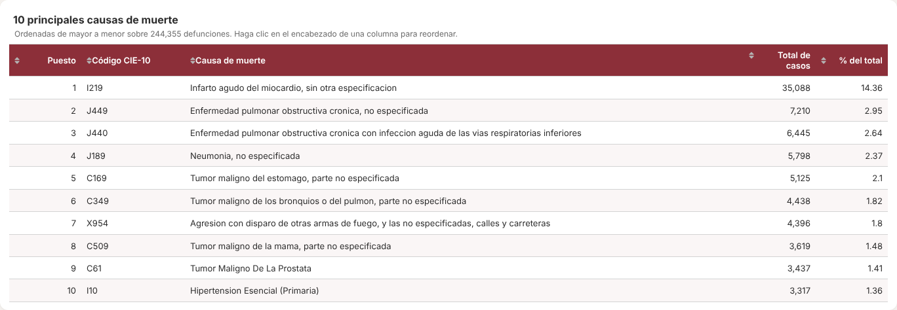
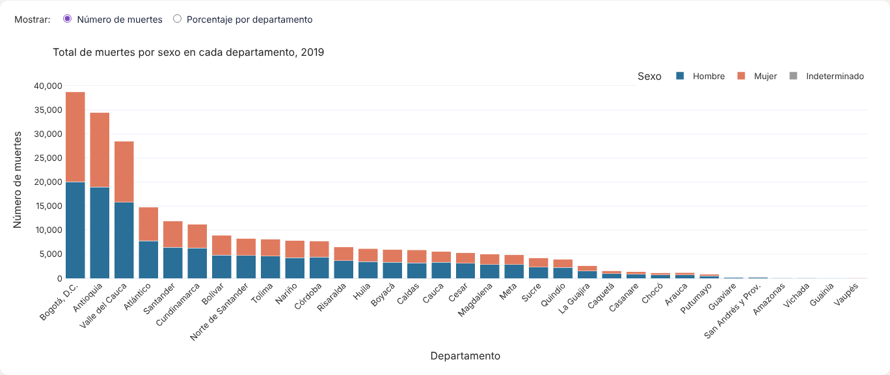
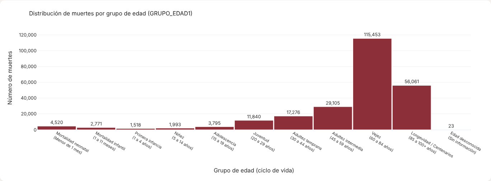

# Mortalidad en Colombia 2019: aplicación web interactiva

**Curso:** Aplicaciones I. Maestría en Inteligencia Artificial, Universidad de La Salle
**Actividad 4:** Aplicación web interactiva para el análisis de mortalidad en Colombia (grupal)

**Integrantes:**

- Samuel Andrés Cubillos Carantonio

**Aplicación desplegada:** https://_[nombre-del-servicio]_.onrender.com
**Repositorio:** https://github.com/_[usuario]_/mortalidad-colombia-2019

---

## 1. Introducción

Esta aplicación web se hizo en Python con **Dash** y **Plotly**. Sirve para explorar de forma interactiva las **244.355 defunciones no fetales** que registró el DANE en Colombia durante 2019 (Estadísticas Vitales, EEVV). Une tres fuentes oficiales: los microdatos de mortalidad, el catálogo de causas CIE-10 y la División Político-Administrativa (DIVIPOLA). Con ellas presenta siete visualizaciones que ayudan a ver patrones demográficos, temporales y regionales de la mortalidad en el país.

## 2. Objetivo

Analizar la mortalidad en Colombia en 2019 para responder estas preguntas:

- ¿Cómo se distribuyen las muertes entre los departamentos?
- ¿Cambia la mortalidad de un mes a otro?
- ¿Qué ciudades concentran más homicidios por arma de fuego y cuáles registran menos muertes?
- ¿Cuáles son las principales causas de muerte?
- ¿Hay diferencias entre hombres y mujeres por departamento?
- ¿En qué etapas del ciclo de vida se concentra la mortalidad?

La aplicación tiene **filtros globales**: departamento, sexo, manera de muerte y rango de meses. También permite **hacer clic en el mapa** para enfocar todos los gráficos en un departamento.

## 3. Estructura del proyecto

```
mortalidad-colombia-2019/
├── app.py                         # Aplicación Dash (layout, gráficos y callbacks)
├── requirements.txt               # Dependencias con versiones fijas
├── Procfile                       # Comando de arranque para la PaaS (gunicorn)
├── render.yaml                    # Configuración de despliegue en Render (Blueprint)
├── .python-version                # Versión de Python para el despliegue
├── assets/
│   ├── estilos.css                # Estilos de la interfaz (Dash los carga solo)
│   └── topojson/                  # Mapa base de Plotly servido localmente
├── data/
│   ├── raw/                       # Archivos originales del DANE
│   │   ├── NoFetal2019.xlsx
│   │   ├── CodigosDeMuerte.xlsx
│   │   └── Divipola.xlsx
│   ├── processed/
│   │   ├── mortalidad_2019.csv.gz # Base unificada que usa la app
│   │   └── codigos_muerte.csv     # Catálogo CIE-10 limpio
│   └── colombia_departamentos.geojson  # Polígonos de los 33 departamentos (MGN 2018)
├── scripts/
│   └── preparar_datos.py          # Limpieza y unión de las tres fuentes
└── docs/capturas/                 # Capturas de pantalla usadas en este README
```

**Flujo de datos:** `data/raw/*.xlsx` → `scripts/preparar_datos.py` → `data/processed/mortalidad_2019.csv.gz` → `app.py`.
El preprocesamiento hace cuatro cosas:

1. Normaliza los códigos DANE (5 dígitos para municipio y 2 para departamento).
2. Une los nombres de departamento y municipio de DIVIPOLA.
3. Asigna el nombre de la causa CIE-10. Busca primero el código de 4 caracteres y, si no lo encuentra, el de 3.
4. Agrupa `GRUPO_EDAD1` en las 11 categorías del ciclo de vida que define la actividad.

Todos los registros quedaron con departamento, municipio y causa asignados. Ningún registro se perdió.

## 4. Requisitos

| Librería | Versión                               |
| -------- | ------------------------------------- |
| Python   | 3.13                                  |
| dash     | 4.4.1                                 |
| plotly   | 7.1.0                                 |
| pandas   | 3.0.5                                 |
| numpy    | 2.5.3                                 |
| openpyxl | 3.1.5 (solo para `preparar_datos.py`) |
| gunicorn | 26.2.0 (servidor de producción)       |

## 5. Software utilizado

- **Python 3.13**: lenguaje de programación.
- **Pandas**: limpieza, unión y agregación de datos.
- **Plotly Express / Graph Objects**: gráficos interactivos.
- **Dash**: framework para la aplicación web y su interactividad (callbacks).
- **Gunicorn**: servidor WSGI para producción.
- **Git y GitHub**: control de versiones y repositorio.
- **Render**: plataforma como servicio (PaaS) para el despliegue.
- **Visual Studio Code**: editor de código.

## 6. Instalación y ejecución local

```bash
# 1. Clonar el repositorio
git clone https://github.com/<usuario>/mortalidad-colombia-2019.git
cd mortalidad-colombia-2019

# 2. Crear y activar un entorno virtual
python -m venv venv
# Windows:
venv\Scripts\activate
# macOS / Linux:
source venv/bin/activate

# 3. Instalar dependencias
pip install -r requirements.txt

# 4. (Opcional) Regenerar la base procesada desde los Excel originales
python scripts/preparar_datos.py

# 5. Ejecutar la aplicación
python app.py
```

Luego abra **http://127.0.0.1:8050** en el navegador.

## 7. Despliegue en Render

1. Suba el proyecto a un repositorio **público** de GitHub:
   ```bash
   git init
   git add .
   git commit -m "Aplicación Dash mortalidad Colombia 2019"
   git branch -M main
   git remote add origin https://github.com/<usuario>/mortalidad-colombia-2019.git
   git push -u origin main
   ```
2. Ingrese a https://render.com con su cuenta de GitHub.
3. Seleccione **New → Web Service** y conecte el repositorio.
4. Configure el servicio:
   - **Runtime:** Python 3
   - **Build Command:** `pip install -r requirements.txt`
   - **Start Command:** `gunicorn app:server --workers 1 --timeout 120`
   - **Instance type:** Free
   - **Environment variable:** `PYTHON_VERSION = 3.13.0`

   Otra opción es **New → Blueprint**, que lee el archivo `render.yaml` y crea el servicio con esta configuración.

5. Pulse **Create Web Service** y espere a que el registro muestre _"Your service is live"_.
6. Render asigna una URL pública del tipo `https://mortalidad-colombia-2019.onrender.com`.

> En el plan gratuito, el servicio se suspende tras 15 minutos sin uso. La primera visita después de eso puede tardar unos 50 segundos en cargar.

`app.py` expone `server = app.server`. Ese es el objeto WSGI que usa Gunicorn (`app:server`). La aplicación consume unos 130 MB de RAM, bastante menos que los 512 MB del plan gratuito.

## 8. Visualizaciones y resultados

### Vista general e interactividad



En la parte superior hay **filtros** (departamento, sexo, manera de muerte y rango de meses) y **cinco indicadores**: total de muertes, hombres, mujeres, homicidios y mes con más muertes. Todos los gráficos se recalculan cuando cambia cualquier filtro. Si se hace clic en un departamento del mapa, ese departamento queda seleccionado y el resto de la página se enfoca en él. El botón _Restablecer filtros_ vuelve a la vista nacional.



_Ejemplo con el filtro aplicado a Antioquia: 34.473 defunciones, 2.366 homicidios, y diciembre como el mes con más muertes (3.055)._

### 8.1 Mapa: muertes por departamento



Mapa coroplético con el total de defunciones de 2019 en cada departamento. La escala va de rojo claro (menos muertes) a rojo oscuro (más muertes).

**Hallazgos:** la mortalidad se concentra en los departamentos más poblados. **Bogotá D.C. (38.760)**, **Antioquia (34.473)** y **Valle del Cauca (28.443)** suman el **42 %** de las muertes del país. Les siguen Atlántico (14.804) y Santander (11.894). En el otro extremo están los departamentos de la Amazonía y la Orinoquía: Vaupés (87), Guainía (115), Vichada (188) y Amazonas (190). Estos números son **conteos absolutos**. Reflejan sobre todo el tamaño de la población, no el riesgo de morir, que solo podría medirse con una tasa por 100.000 habitantes.

### 8.2 Gráfico de líneas: muertes por mes



**Hallazgos:** la mortalidad mensual se mantuvo estable, con un promedio de unas **20.363 muertes por mes**. **Febrero** tuvo el mínimo (17.974), en parte porque solo tiene 28 días. **Diciembre** tuvo el máximo (21.678), seguido de julio (21.372) y enero (21.354). Los picos de fin y comienzo de año coinciden con temporadas festivas, en las que suelen aumentar los accidentes y las agresiones, y con temporadas de enfermedad respiratoria.

### 8.3 Barras: las 5 ciudades más violentas



Por defecto se cuentan los homicidios con código CIE-10 **X95** (_agresión con disparo de otras armas de fuego y las no especificadas_), como pide la actividad. Un selector permite cambiar al criterio de _todos los homicidios_ (manera de muerte = Homicidio).

**Hallazgos (X95):**

| Puesto | Ciudad             | Homicidios X95 |
| ------ | ------------------ | -------------- |
| 1      | Santiago de Cali   | 971            |
| 2      | Bogotá D.C.        | 601            |
| 3      | Medellín           | 428            |
| 4      | Barranquilla       | 260            |
| 5      | San José de Cúcuta | 206            |

Cali registra **más homicidios con arma de fuego que Bogotá**, aunque su población es cerca de un tercio de la de la capital. Eso indica una violencia armada mucho más intensa en proporción. El **93,5 %** de las víctimas por X95 en el país fueron **hombres**. Con el criterio de todos los homicidios, el orden de las cinco ciudades es el mismo (Cali 1.242, Bogotá 1.154, Medellín 638, Barranquilla 345, Cúcuta 262).

### 8.4 Gráfico circular: las 10 ciudades con menor mortalidad



Muestra los 10 municipios con menos defunciones registradas en 2019 (solo se cuentan los que tienen al menos una).

**Hallazgos:** **13 municipios** registraron **una sola defunción** en todo el año. Por eso los 10 que aparecen tienen el mismo valor, y los empates se ordenan alfabéticamente: Alto Baudó y Nuquí (Chocó); Bituima (Cundinamarca); El Calvario (Meta); El Encanto y Puerto Alegría (Amazonas); Hato (Santander); La Tola (Nariño); Mapiripana (Guainía); Margarita (Bolívar). Son municipios pequeños o áreas no municipalizadas de zonas rurales y apartadas. Un conteo tan bajo puede deberse a la poca población, pero también al **subregistro** de defunciones en zonas de difícil acceso. Con el filtro de departamento, el gráfico muestra los municipios con menos muertes dentro de ese departamento, y ahí sí aparecen diferencias.

### 8.5 Tabla: las 10 principales causas de muerte



| #   | Código | Causa                                                         | Casos  | %     |
| --- | ------ | ------------------------------------------------------------- | ------ | ----- |
| 1   | I219   | Infarto agudo del miocardio, sin otra especificación          | 35.088 | 14,36 |
| 2   | J449   | EPOC, no especificada                                         | 7.210  | 2,95  |
| 3   | J440   | EPOC con infección aguda de las vías respiratorias inferiores | 6.445  | 2,64  |
| 4   | J189   | Neumonía, no especificada                                     | 5.798  | 2,37  |
| 5   | C169   | Tumor maligno del estómago, parte no especificada             | 5.125  | 2,10  |
| 6   | C349   | Tumor maligno de bronquios o pulmón, parte no especificada    | 4.438  | 1,82  |
| 7   | X954   | Agresión con disparo de arma de fuego, en calles y carreteras | 4.396  | 1,80  |
| 8   | C509   | Tumor maligno de la mama, parte no especificada               | 3.619  | 1,48  |
| 9   | C61    | Tumor maligno de la próstata                                  | 3.437  | 1,41  |
| 10  | I10    | Hipertensión esencial (primaria)                              | 3.317  | 1,36  |

**Hallazgos:** el **infarto agudo del miocardio** es por mucho la primera causa de muerte. Causa **1 de cada 7 defunciones** y casi quintuplica a la segunda causa. Las enfermedades crónicas no transmisibles dominan la lista: cardiovasculares (I219, I10), respiratorias crónicas (EPOC, J449 y J440, que juntas suman 13.655 casos) y cáncer (estómago, pulmón, mama y próstata). La única causa externa del top 10 es el **homicidio con arma de fuego en vía pública (X954)**, en el séptimo lugar. Esto muestra el peso de la violencia en el perfil de mortalidad del país.

### 8.6 Barras apiladas: muertes por sexo y departamento



Un selector permite ver **números absolutos** o **porcentajes dentro de cada departamento**. La vista en porcentajes facilita comparar departamentos de distinto tamaño.

**Hallazgos:** en Colombia murieron más hombres (**55,1 %**, 134.573) que mujeres (**44,9 %**, 109.689). Los 93 casos restantes (0,04 %) tienen sexo indeterminado. Todos los departamentos muestran sobremortalidad masculina, pero con intensidades distintas:

- La diferencia es menor en **Bogotá (51,7 % hombres)**, **Atlántico (52,5 %)** y **Bolívar (53,8 %)**, departamentos urbanos con población más envejecida.
- Es mucho mayor en **Guaviare (76,8 %)**, **Guainía (67,8 %)**, **Amazonas (65,8 %)**, **Vichada (64,9 %)** y **Putumayo (64,0 %)**. Esto puede relacionarse con más muertes por causas externas (violencia, accidentes) en territorios afectados por el conflicto armado y con economías extractivas.

### 8.7 Histograma: distribución por grupo de edad



Agrupa `GRUPO_EDAD1` en las 11 categorías del ciclo de vida que define la actividad (de _mortalidad neonatal_ hasta _longevidad / centenarios_).

**Hallazgos:** la mortalidad se concentra en las edades avanzadas. La **vejez (60 a 84 años)** reúne el **47,2 %** de las muertes (115.453) y la **longevidad (85 años o más)** el **22,9 %** (56.061). Es decir, casi **7 de cada 10 personas fallecidas tenían 60 años o más**, lo que es propio de un país en transición demográfica. Hay también un aumento visible desde la **juventud (20 a 29 años, 11.840)**, que supera a la adolescencia y la niñez y coincide con la edad de mayor riesgo de muerte violenta. La **mortalidad neonatal (4.520)** supera a la primera infancia y la niñez juntas (3.511), lo que muestra que el primer mes de vida es un periodo crítico. Solo 23 registros tienen edad desconocida, lo que habla bien de la calidad del dato.

## 9. Conclusiones

1. La mortalidad en Colombia en 2019 sigue un patrón de **enfermedades crónicas en personas mayores**. Infarto, EPOC y cáncer encabezan las causas, y 7 de cada 10 personas fallecidas tenían 60 años o más.
2. La **violencia armada** sigue siendo un rasgo propio del país. Es la única causa externa en el top 10, afecta casi siempre a hombres jóvenes y se concentra en grandes ciudades, sobre todo **Cali**.
3. La distribución territorial de las muertes sigue la distribución de la población. Para comparar el riesgo entre territorios haría falta calcular **tasas** con proyecciones de población del DANE. Esa es la extensión natural de este trabajo.
4. Dash y Plotly permiten convertir más de 244 mil registros en una herramienta web interactiva, accesible desde cualquier navegador y desplegada sin costo en una PaaS.

## 10. Fuentes

- Departamento Administrativo Nacional de Estadística [DANE]. (2020). _Estadísticas Vitales - EEVV - 2019_ [Conjunto de datos]. https://microdatos.dane.gov.co/index.php/catalog/696
- DANE. (2018). _Marco Geoestadístico Nacional: departamentos_ [GeoJSON]. Usado para los polígonos del mapa.
- Plotly Technologies Inc. (2026). _Dash documentation_. https://dash.plotly.com
